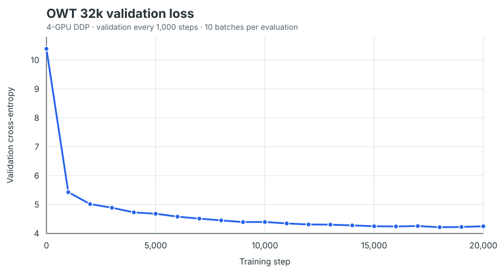

# OWT 32k A1 训练记录

这份记录对应 CS336 Assignment 1 的 OpenWebText（OWT）语言模型训练。训练已完成 20,000 步，使用 4 卡 DDP。原始语料、token id 数组和最终 checkpoint 保存在训练服务器，不放入 GitHub；仓库只保存可复核的轻量指标 CSV 和 loss 图。

## 结果

| 指标 | 结果 |
|---|---:|
| 最终训练步数 | 20,000 |
| 处理 token 数 | 327,680,000 |
| 初始验证 loss（step 0） | 10.3898 |
| 最终验证 loss（step 20,000） | **4.2499** |
| 最佳验证 loss | **4.2172（step 18,000）** |
| 最后记录的训练 batch loss | 4.3394（step 19,990） |
| 验证方式 | 每 1,000 步评估；每次 10 个 batch |

训练 loss 是单个训练 batch 的交叉熵，波动较大；比较整体趋势时应看验证 loss。验证 loss 来自每次抽取的 10 个 batch，并非完整遍历验证集。

完整、去重并按最终 checkpoint 恢复轨迹整理的指标在 [`outputs/logs/owt_32k_metrics.csv`](../outputs/logs/owt_32k_metrics.csv)。初次运行在 step 10,000 的 checkpoint 之后继续运行过一段时间，随后从 step 10,000 checkpoint 恢复；CSV 丢弃了 checkpoint 之后、被恢复运行覆盖的旧日志，只保留最终模型实际采用的轨迹。

## 硬件与软件

| 项目 | 实测环境 |
|---|---|
| GPU | 4 张 NVIDIA RPBZZZ6，使用物理 GPU 4、5、6、7；每张 97,887 MiB 显存（约 95.6 GiB），compute capability 12.0 |
| 并行方式 | PyTorch DistributedDataParallel，4 个进程，每卡一个进程 |
| CPU | Intel Xeon Platinum 8558P，2 个 socket、每 socket 45 核、每核 2 线程；系统报告 180 个逻辑 CPU |
| 内存 | Linux 报告总内存 1.8 TiB |
| 软件 | Linux x86_64，PyTorch 2.11.0+cu130，CUDA 13.0，NCCL 2.28.9 |

服务器内部 hostname 和连接地址不写入公开仓库。

## 模型与训练参数

| 参数 | 设置 |
|---|---:|
| 数据集 / tokenizer | OpenWebText；BPE vocab 32,000，merge 数 31,743 |
| 模型 | `d_model=512`，4 层，16 个 attention heads，`d_ff=1344`，context length 256 |
| 每卡 batch / 全局 batch | 16 / 64 |
| 训练步数 | 20,000 |
| 精度 | FP32（训练入口未启用 autocast/mixed precision） |
| 优化器 | AdamW；`beta1=0.9`，`beta2=0.95`，`eps=1e-8`，`weight_decay=0.01` |
| 梯度裁剪 | max norm 1.0 |
| 学习率 | max `3e-4`，min `3e-5`；warmup 100 步；cosine cycle 20,000 步 |
| 验证 | 每 1,000 步，`eval_iters=10` |
| checkpoint | 每 5,000 步保存；完成时另保存最终 checkpoint |
| 日志 | 每 10 步写训练 loss |
| 随机种子 | 0（DDP 每个 rank 加 rank 偏移） |

训练集有 2,727,120,452 个 token，验证集有 66,401,098 个 token。20,000 × 64 × 256 = 327,680,000 个 token 是训练采样预算；mini-batch 通过随机位置采样，因此不代表按顺序完成了一遍语料。

## 训练耗时与恢复

日志没有在每条训练记录中写 wall-clock 时间。根据训练输出文件与 controller/status 文件的时间戳推算：第一段约 8 分 43 秒，恢复段约 8 分 42 秒，累计活动时长约 **17 分 25 秒**。第一段起点取 tokenization 日志完成时间，恢复段起点取恢复 controller 启动时间；因此这是进程级近似值，不是 GPU kernel 时间，也不包含两段之间等待恢复的时间。第一段在保存 step 10,000 checkpoint 后被中断，step 10,001–11,750 的未保存计算由恢复任务重新执行。

OWT 的 32k BPE 构建另外耗时约 **21 分 25 秒**（单独的 tokenizer 状态文件记录），不计入上面的模型训练时间。

## 复现与文件保留

训练入口为 `scripts/run_owt_training_pipeline.py`，配置默认使用 GPU 4–7。训练依赖服务器上的 OWT 原始文本、32k BPE 文件和 tokenized arrays；它们没有提交到仓库。最终 checkpoint `outputs/checkpoints/owt_32k_latest.pt` 约 518 MiB，也保留在服务器，避免仓库膨胀。服务器项目目录为 `hjl-cs336-assignments/assignment1-basics`。

轻量结果文件：

- [`outputs/logs/owt_32k_metrics.csv`](../outputs/logs/owt_32k_metrics.csv)：合并后的训练与验证指标。
- [`outputs/figures/owt_32k_validation_loss.svg`](../outputs/figures/owt_32k_validation_loss.svg)：从 CSV 验证点生成的曲线。
