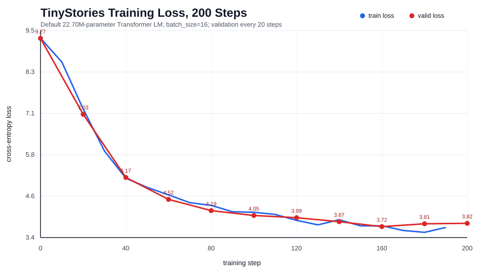

# MiniGPT from Scratch 项目报告

## 项目概述

本项目从零实现一个 GPT 风格的小型语言模型训练系统，目标是把 CS336 Assignment 1 中的 tokenizer、Transformer、optimizer、训练循环和生成流程整理成一个可复现实验项目。项目没有调用 HuggingFace 的现成模型，而是自己实现 BPE tokenizer、RoPE causal self-attention、RMSNorm、SwiGLU、AdamW、学习率调度、checkpoint 和自回归生成。

## 模型配置

| 项目 | 数值 |
|---|---:|
| dataset | TinyStories |
| vocab size | 10,000 |
| context length | 256 |
| d_model | 512 |
| layers | 4 |
| attention heads | 16 |
| d_ff | 1,344 |
| parameter count | 22,696,448 |
| optimizer | AdamW |
| learning rate schedule | warmup + cosine decay |

## 实验结果摘要

| 指标 | 结果 |
|---|---:|
| CS336 tests | 47 passed, 1 xpassed |
| 200-step run train loss | 9.2741 -> 3.6981 |
| 200-step run valid loss | 9.2704 -> 3.8196 |
| 200-step run best valid loss | 3.7223 at step 160 |
| checkpoint valid loss | 2.0899 |
| checkpoint perplexity | 8.08 |

## OWT 32k 四卡训练

在 OpenWebText 上完成了 Assignment 1 的 20,000 步训练，使用物理 GPU 4–7 进行四卡 DDP。模型配置为 vocab size 32,000、context length 256、`d_model=512`、4 层、16 个 heads、`d_ff=1344`，每卡 batch 16、全局 batch 64。最终 validation loss 为 4.2499，最佳验证 loss 为 4.2172（step 18,000）。详细硬件、参数、恢复过程与耗时口径见[OWT 训练记录](OWT训练与结果.md)；完整指标和曲线分别保存在 `outputs/logs/owt_32k_metrics.csv` 与 `outputs/figures/owt_32k_validation_loss.svg`。数据集、tokenized arrays 和 checkpoint 没有上传。

## 训练过程数据

完整 CSV 位于 `outputs/logs/tinystories_report_train.csv`，下表保留 validation 点和若干 train-only 点：

| step | train loss | valid loss | learning rate |
|---:|---:|---:|---:|
| 0 | 9.2741 | 9.2704 | 0 |
| 20 | 7.1900 | 7.0320 | 0.0003 |
| 40 | 5.1498 | 5.1713 | 0.000291859 |
| 50 | 4.8782 |  | 0.000281913 |
| 60 | 4.6583 | 4.5246 | 0.000268416 |
| 80 | 4.3485 | 4.1937 | 0.0002325 |
| 100 | 4.1452 | 4.0494 | 0.000188443 |
| 120 | 3.9072 | 3.9857 | 0.000141557 |
| 140 | 3.9252 | 3.8672 | 9.75e-05 |
| 150 | 3.7439 |  | 7.82237e-05 |
| 160 | 3.7477 | 3.7223 | 6.1584e-05 |
| 180 | 3.5539 | 3.8059 | 3.81415e-05 |
| 190 | 3.6981 |  | 3.2051e-05 |
| 200 |  | 3.8196 |  |

## 图表

## 结果解读

200-step 复现实验主要用于展示训练过程：train loss 从 9.2741 降到 3.6981，validation loss 从 9.2704 降到 3.8196，说明训练 loop、optimizer、学习率调度和验证逻辑是有效的。已有的 `tinystories_ckpt_5k.pt` checkpoint 进一步说明模型在更长训练后达到了 validation loss 2.0899、perplexity 8.08，比短跑实验更能代表最终模型质量。

## 简历表述建议

- 从零实现 22.70M 参数 GPT 风格语言模型训练系统，包含 BPE tokenizer、RoPE causal self-attention、RMSNorm、SwiGLU、AdamW、学习率调度、checkpoint 和自回归文本生成。
- 搭建 TinyStories 训练与评估流水线，支持 tokenization、mini-batch 采样、validation loss 评估、CSV 日志记录和 SVG loss 曲线可视化；最终 checkpoint validation loss 为 2.0899，perplexity 为 8.08。
